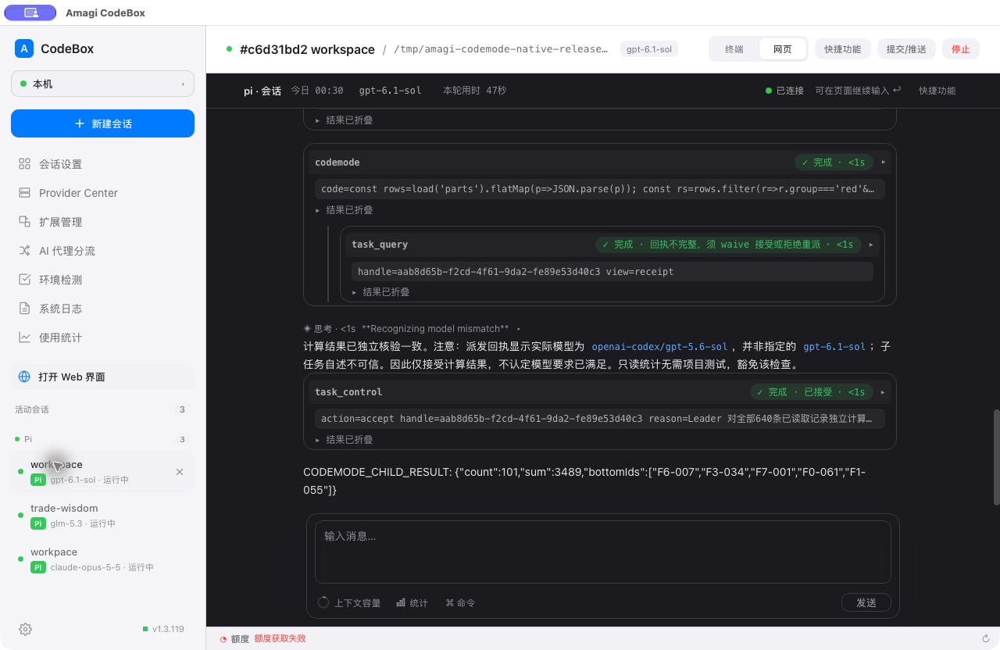

# CodeMode 发行、安装与原生执行验收

## 发布与安装

| 项目 | 版本 / 发行提交 | 发行与安装核验 |
|---|---|---|
| amagi-pi | 2.21.16 / `75e4b0f2dd286d62808649c13b0f88852d2368dc` | [Release](https://github.com/runrunrain/amagi-pi/releases/tag/v2.21.16)；通过 `pi update git:github.com/runrunrain/amagi-pi` 更新，本机版本和 commit 一致 |
| CodeBox | 1.3.120 / `beee6152f4b0a456dcbafd062b9cd1b68cbe780a` | [Release](https://github.com/runrunrain/amagi-codebox/releases/tag/v1.3.120)；下载公开发行的 darwin-arm64 ZIP，核验后更新本机 `.app` 并备份 1.3.119 |

CodeBox 的 macOS arm64 与 Windows amd64 [发行工作流](https://github.com/runrunrain/amagi-codebox/actions/runs/40171388277) 均成功。两平台可执行文件的 Go build metadata 均为 `v1.3.120`、commit `beee615`；Mac plist 的两个版本字段均为 `1.3.120`。

| 文件 | SHA-256 |
|---|---|
| darwin-arm64.zip | `39b30a57ddd874de5e9cd476fd856b1378ad0f636ff455f2e781678df82f06e3` |
| windows-amd64.zip | `f480422928190ce522d1ef7403038c074fcfb8d88ad3ef2a11e52cb9b51d33db` |
| Mac 已安装 executable（与发行包一致） | `7b90a52c0104ff85cdff083a197c19ee12a638caaf83ebe295571a3750affe66` |

## 已完成的原生 Agent 验证

用户要求保留正在执行的旧任务，等任务结束后再重启。因此保留旧 CodeBox 1.3.119 的执行进程，在该原生窗口中正常启动新的 Pi 会话，使用已经正式安装的 amagi-pi 2.21.16。未注入源码 extension，未使用固定 provider 剧本或模拟 Wails 桥。此处证明新安装插件的原生执行链，不冒充 CodeBox 1.3.120 配置界面验收。

隔离夹具包含八份 JSON、每份 80 条。原全局配置没有 `codemode` 节，项目配置只指定模型及 MCP 路由，没有 CodeMode 激活、角色授权或预算账户。任务未强制指定使用 CodeMode：Leader 第一次查询的提示只要求自行选择合适已有工具，子任务也自行选择工具。

| 验证 | 原生记录 | 结果 |
|---|---|---|
| Leader 自主选择 | 会话 `01a171f8-164e-70e9-a603-f2829a160e1b`，模型 `openai-codex/gpt-6.1-sol` | 首次 CodeMode 合并 8 次真实 read，随后在脚本内核验；count=119、sum=8512，排序结果与独立计算一致 |
| 一次派发子任务 | 同一 Leader 直接 `task_submit`，正文同次提交，scope 没有 `codemode` | 经原契约内核创建任务 `aab8d65b-f2cd-4f61-9da2-fe89e53d40c3`；无前置任务文件 Write |
| 子 agent 自主选择 | 会话 `01a171fc-9cfd-74f4-87b8-0312d07f8fda`，原生模型元数据为 `openai-codex/gpt-5.6-sol` | 自主使用 CodeMode 完成 8 次真实 read；count=101、sum=3489，排序结果与独立计算一致 |
| 原任务权限 | policyVersion=1，shell=deny、write/reportFiles 为空；tools 自动含 codemode，没有 `permission.codemode` 子对象 | CodeMode 未申请独立授权；全部输入文件字节不变 |
| 验收 | Leader 通过 CodeMode 查询当前回执，然后按 receiptId/revision 接受 | 最终三轴 `done / incomplete / accepted`；数据夹具无测试命令，Leader 明确豁免 unavailable 自动基线，没有将其记为 ready |

测试提示提到了 gpt-6.1-sol，但项目为 Luban 配置的是 gpt-5.6-sol。子任务文本自述模型不准确，Leader 已根据原生回执指出不一致，只接受计算结果而不认定指定模型要求满足。本表采用原生消息元数据，不采用模型自述。

[脱敏原生调用与内核数据](2026-10-24-codemode-native-results.json)。截图底部的额度探测不可用，未将额度接口作为通过依据。

验证会话已关闭，原生历史保留；启动选择恢复为原有提供商、预设及工作目录，原先两个会话继续运行。全局 amagi.json 与验证前一致。

## 待原任务结束后完成

CodeBox 1.3.120 已安装并启动独立进程，但窗口控制仍绑定旧实例。用户明确选择“保留现有任务，结束后再重启”，因此尚未退出旧实例，也尚未把新版 CodeMode 卡片保存/重新加载记为通过。

已在当前聊天设置每 5 分钟的静默跟进：只读确认原有任务和 Leader 均空闲后，正常重启，再在真实 1.3.120 中完成 CodeMode 偏好及默认值保存、离开回读、磁盘字段比较；保留其他配置并最终使用 auto。完成后回填本节并停止跟进。

## 检查结果与已知基线

- Pi `npm run test:ci`：5312 通过、9 项既有门控跳过、0 失败；类型、依赖及生成文档门禁通过。包 dry-run 确认包含 CodeMode runtime 和 schema。
- CodeBox 本机 `go test ./...`、`go vet ./...`，桌面前端 331 项、移动前端 669 项测试、两端构建和配置组件 9 项交互验证通过。
- [完整云端 CI](https://github.com/runrunrain/amagi-codebox/actions/runs/40171452538)：Frontend and mobile 成功，Go 两平台被旧全仓 lint 问题拦截（macOS 22、Windows 25），未宣称完整 CI 成功。标准化诊断与此前旧版基线逐项一致，零新增，报错文件均未被本次发行修改。[对照数据](2026-10-24-codemode-ci-baseline.json)。
- 原有 `build.sh`、`build.bat` 修改未进入发行提交；未覆盖或清理这些改动。发行 tag 与资产未重写。
