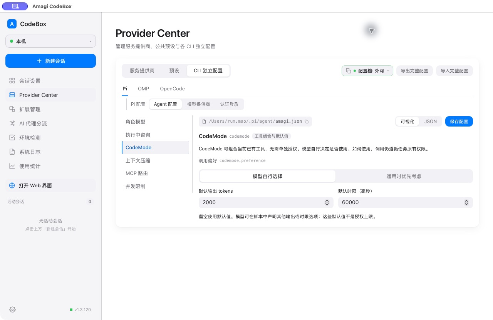

# CodeMode 发行、安装与原生执行验收

## 发布与安装

| 项目 | 版本 / 发行提交 | 发行与安装核验 |
|---|---|---|
| amagi-pi | 2.21.16 / `75e4b0f2dd286d62808649c13b0f88852d2368dc` | [Release](https://github.com/runrunrain/amagi-pi/releases/tag/v2.21.16)；通过 `pi update git:github.com/runrunrain/amagi-pi` 更新，本机版本和 commit 一致 |
| CodeBox | 1.3.120 / `beee6152f4b0a456dcbafd062b9cd1b68cbe780a` | [Release](https://github.com/runrunrain/amagi-codebox/releases/tag/v1.3.120)；下载公开发行的 darwin-arm64 ZIP，核验后更新本机 `.app` 并备份 1.3.119 |

CodeBox 的 macOS arm64 与 Windows amd64 [发行工作流](https://github.com/runrunrain/amagi-codebox/actions/runs/40171388277) 均成功。两平台可执行文件的 Go build metadata 均为 `v1.3.120`、commit `beee615`；Mac plist 的两个版本字段均为 `1.3.120`。

| 文件 | SHA-256 |
|---|---|
| darwin-arm64.zip | `39b30a57ddd874de5e9cd476fd856b1378ad0f636ff455f2e781678df82f06e3` |
| windows-amd64.zip | `f480422928190ce522d1ef7403038c074fcfb8d88ad3ef2a11e52cb9b51d33db` |
| Mac 已安装 executable（与发行包一致） | `7b90a52c0104ff85cdff083a197c19ee12a638caaf83ebe295571a3750affe66` |

## 已完成的原生 Agent 验证

用户要求保留正在执行的旧任务，等任务结束后再重启。因此保留旧 CodeBox 1.3.119 的执行进程，在该原生窗口中正常启动新的 Pi 会话，使用已经正式安装的 amagi-pi 2.21.16。未注入源码 extension，未使用固定 provider 剧本或模拟 Wails 桥。此处证明新安装插件的原生执行链，不冒充 CodeBox 1.3.120 配置界面验收。

隔离夹具包含八份 JSON、每份 80 条。原全局配置没有 `codemode` 节，项目配置只指定模型及 MCP 路由，没有 CodeMode 激活、角色授权或预算账户。任务未强制指定使用 CodeMode：Leader 第一次查询的提示只要求自行选择合适已有工具，子任务也自行选择工具。

| 验证 | 原生记录 | 结果 |
|---|---|---|
| Leader 自主选择 | 会话 `01a171f8-164e-70e9-a603-f2829a160e1b`，模型 `openai-codex/gpt-6.1-sol` | 首次 CodeMode 合并 8 次真实 read，随后在脚本内核验；count=119、sum=8512，排序结果与独立计算一致 |
| 一次派发子任务 | 同一 Leader 直接 `task_submit`，正文同次提交，scope 没有 `codemode` | 经原契约内核创建任务 `aab8d65b-f2cd-4f61-9da2-fe89e53d40c3`；无前置任务文件 Write |
| 子 agent 自主选择 | 会话 `01a171fc-9cfd-74f4-87b8-0312d07f8fda`，原生模型元数据为 `openai-codex/gpt-5.6-sol` | 自主使用 CodeMode 完成 8 次真实 read；count=101、sum=3489，排序结果与独立计算一致 |
| 原任务权限 | policyVersion=1，shell=deny、write/reportFiles 为空；tools 自动含 codemode，没有 `permission.codemode` 子对象 | CodeMode 未申请独立授权；全部输入文件字节不变 |
| 验收 | Leader 通过 CodeMode 查询当前回执，然后按 receiptId/revision 接受 | 最终三轴 `done / incomplete / accepted`；数据夹具无测试命令，Leader 明确豁免 unavailable 自动基线，没有将其记为 ready |

测试提示提到了 gpt-6.1-sol，但项目为 Luban 配置的是 gpt-5.6-sol。子任务文本自述模型不准确，Leader 已根据原生回执指出不一致，只接受计算结果而不认定指定模型要求满足。本表采用原生消息元数据，不采用模型自述。

[脱敏原生调用与内核数据](2026-10-24-codemode-native-results.json)。截图底部的额度探测不可用，未将额度接口作为通过依据。


这轮验证会话已关闭，原生历史保留；启动选择恢复为原有提供商、预设及工作目录，未关闭原先两个会话。当时全局 amagi.json 与验证前一致；后续配置验收见下节。

## 新版配置界面保存与回读：通过

用户处理系统钥匙串提示后，重新核验旧进程已退出。CUA 成功打开已安装的原生 CodeBox，侧栏版本明确显示 `v1.3.120`，没有活动会话。未使用源码注入、模拟 Wails 桥或直接写配置文件代替 UI 保存。

验收入口为 Provider Center → CLI 独立配置 → Pi → Agent 配置 → CodeMode。每轮均点击原生“保存配置”，确认“配置已保存”，离开至“会话设置”后重新进入完整配置入口，核对重新加载的值，并独立读取磁盘 JSON。

| 轮次 | 原生界面输入 | 离开后回读与磁盘结果 |
|---|---|---|
| 临时覆盖 | 适用时优先考虑（`prefer`）、3000 tokens、30000 毫秒 | 三项一致，保存成功；相对保存前配置只有 `codemode` 顶层字段变化 |
| 最终配置 | 模型自行选择（`auto`）、2000 tokens、60000 毫秒 | 三项一致，保存成功；相对保存前配置仍只有 `codemode` 顶层字段变化，其他字段语义完全一致 |

最终磁盘值为：

```json
{
  "codemode": {
    "preference": "auto",
    "budget": {
      "maxOutputTokensPerScript": 2000,
      "maxTimeoutMsPerScript": 60000
    }
  }
}
```

界面同时明确这些是模型可覆盖的默认值，CodeMode 无需单独授权，嵌套调用继续遵循原任务权限。验证前私有备份未进入仓库；[脱敏验收数据](2026-10-24-codemode-native-results.json) 仅记录 CodeMode 值、差异字段和散列。最终配置文件 SHA-256 为 `5cc9cfb346faa634662dff6c039f1adefe89f9c56406d0986eb97d4e35e0d2da`。



[临时 prefer 配置的原生回读截图](2026-10-24-codemode-native-config-prefer.jpg)。该截图保留首次启动时的代理端口占用提示；系统提示处理后旧进程退出，复查 18890 已无监听。最终截图前仅关闭本次已读启动提示，没有修改代理配置，也没有将代理恢复记为本项验收。

本轮未创建新测试会话或额外进程；此前 Leader/子 agent 原生执行证据继续有效。原生历史保留，安装 executable 散列和已发布 tag 未变。配置保存回读收尾完成，停止当前聊天的跟进心跳。

## 重启期间的系统提示记录（已解除）

2026-10-25 09:11 UTC，只读确认原 Leader 原生会话最后一条为 `assistant / stop`，并在两个原有 CodeBox 会话中分别确认“可在页面继续输入”、最终回复和可编辑输入框。此前执行中的任务均未被停止、取消、打断或发送消息。

09:12 UTC 在原生窗口执行 Cmd+Q。窗口关闭，日志进入“应用关闭中”，但旧进程没有退出。只读进程采样将主线程定位到 `amagi_set_generic_password → SecKeychainFindGenericPassword → SecurityServer decrypt`，系统同时运行 SecurityAgent。对已经关闭窗口且空闲的旧进程发送一次 SIGTERM 后，进程仍在该调用中等待；未使用 SIGKILL。原生会话 JSONL 保留。

正常启动安装的 1.3.120 后，窗口控制当时仍受旧实例与系统提示阻塞。CUA 对系统提示返回 `Computer Use is not allowed to use the app 'com.apple.SecurityAgent' for safety reasons.`，因此停止操作该提示，通知用户手动处理。阻塞期间全局 `amagi.json` 与验证前备份完全一致，未提前把保存回读记为通过。

用户确认处理后，只读检查旧进程已结束、新版窗口可控，再完成上节真实 UI 验收。同一阻塞等待期间未重复通知、发信号或创建实例。

## 检查结果与已知基线

- Pi `npm run test:ci`：5312 通过、9 项既有门控跳过、0 失败；类型、依赖及生成文档门禁通过。包 dry-run 确认包含 CodeMode runtime 和 schema。
- CodeBox 本机 `go test ./...`、`go vet ./...`，桌面前端 331 项、移动前端 669 项测试、两端构建和配置组件 9 项交互验证通过。
- [完整云端 CI](https://github.com/runrunrain/amagi-codebox/actions/runs/40171452538)：Frontend and mobile 成功，Go 两平台被旧全仓 lint 问题拦截（macOS 22、Windows 25），未宣称完整 CI 成功。标准化诊断与此前旧版基线逐项一致，零新增，报错文件均未被本次发行修改。[对照数据](2026-10-24-codemode-ci-baseline.json)。
- 原有 `build.sh`、`build.bat` 修改未进入发行提交；未覆盖或清理这些改动。发行 tag 与资产未重写。
