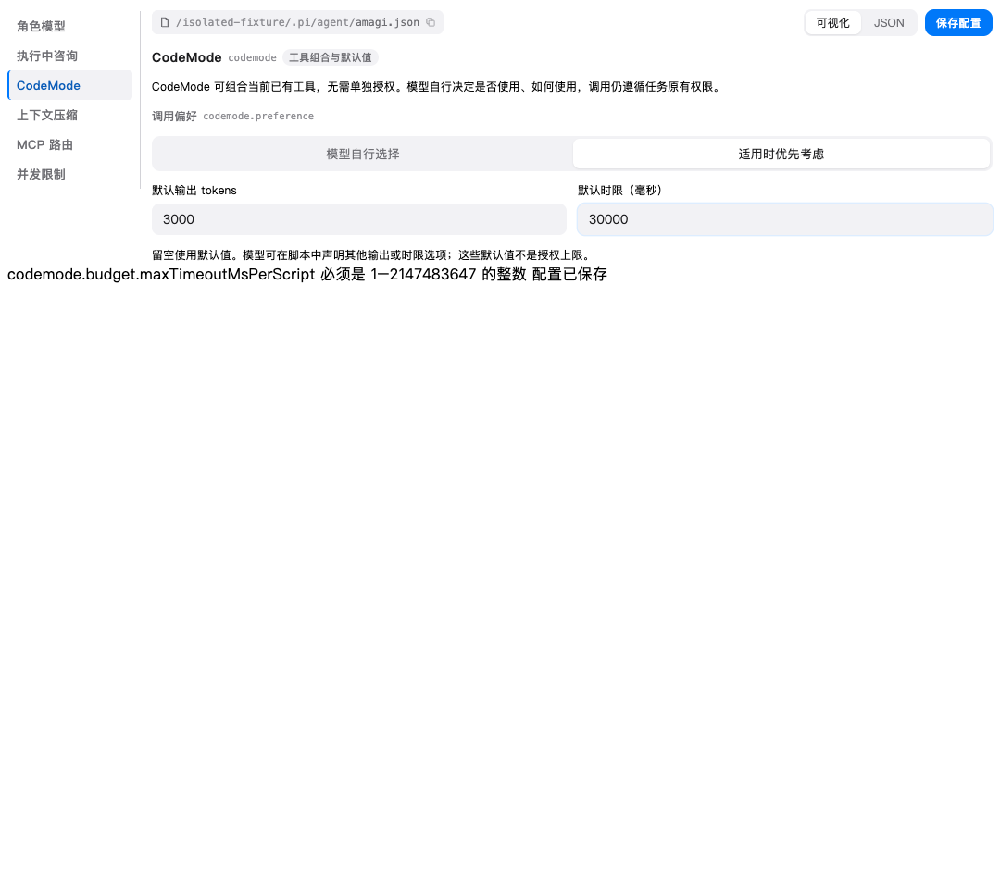

# CodeMode 配置验证

日期：2026-10-24。Pi Agent 配置新增 CodeMode 分区，模型自行选择工具组合，不配置独立角色、只读或 scope 授权。

- 调用偏好：`auto`（默认）或 `prefer`（适用时优先考虑）。
- 运行默认值：输出 2000 tokens、时限 60000ms；可留空继承，也可由模型在脚本选项中覆盖，不作为授权上限。
- 继续使用现有配置保存接口、校验和原子落盘；保留角色模型、咨询、未来字段及旧 CodeMode 数据。
- 非法默认值显示字段错误并阻止保存，切换分区后可通过“CodeMode 待修正”返回错误位置。

验证通过：`go test ./...`、`go vet ./...`；前端 331 项单测、Vue/Vite 构建；`PI_CONFIG_BROWSER_CHANNEL=chrome npx playwright test --config e2e/pi-amagi-config.playwright.config.ts` 的 9 项交互测试。

新增 Go Service 测试在临时目录真实保存/回读，断言其他字段完整、文件权限 0600；非法值拒存且原文件不变。浏览器测试使用生产 Vue 组件和隔离保存桥，覆盖保存/重载、非法值、错误分区导航及未暴露授权控制。

本轮验证工作区源码与真实配置组件，未替换已安装桌面应用。
